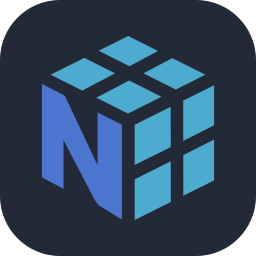
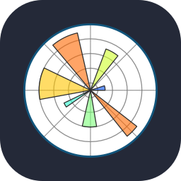
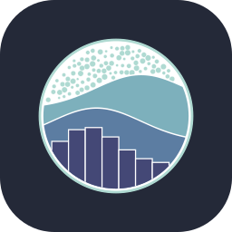
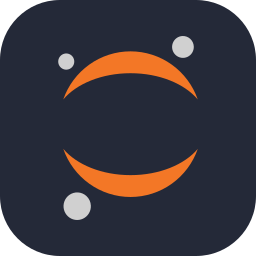
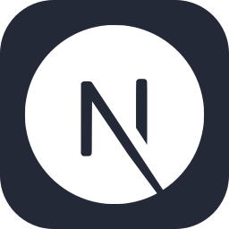
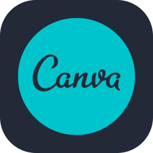

<!-- =========================================================
     IAN KAMAU | GITHUB PROFILE README
     GitHub: ian-qhamau
     ========================================================= -->

<!-- ========================= HEADER ========================= -->

  

<!-- ========================= INTRO ========================= -->

# Hi, I'm Ian Kamau

**Data Science student at the University of Nairobi** interested in the space where data, intelligent systems, security, and software meet. 
What I care about is not simply making something work.I want to understand **why it works, how it can fail, how it can be made safer, and whether it actually solves the problem it was built for**. That mindset has taken me across Data Science, Cybersecurity, Artificial Intelligence, Web Development, and systems that bring several of these areas together.

---

# What I'm Interested In

<table align="center">
  <tr>
    <td align="center" width="190">📊 <b>Data Science</b></td>
    <td align="center" width="190">🤖 <b>Artificial Intelligence</b></td>
    <td align="center" width="190">🛡️ <b>Cybersecurity</b></td>
    <td align="center" width="190">🌐 <b>Web Development</b></td>
  </tr>
</table>

---

# Technical Stack

  
  
  
  
  
  
  
  
  
  
  

  
  
  
  
  
  
  
  

  
  
  
  
  
  
  

  <b>🛡️ Cybersecurity</b> 
  Network Security &nbsp;·&nbsp; Threat Detection &nbsp;·&nbsp; Secure Practices

  Also: Paystack payments · third-party APIs · domain and deployment setup · UX/UI design

---

# GitHub Activity

  

  

  

## Beyond Tech

When I'm not coding, I like playing musical instruments.

There is sometimes a noticeable difference between the musician I imagine I am and the musician that appears when I actually touch the instrument, especially the guitar.

I'm working on closing that gap.

---

# Connect With Me

- LinkedIn: [https://www.linkedin.com/in/ian-kamau-ai](https://www.linkedin.com/in/ian-kamau-ai)
- Portfolio: [https://ian-kamau-portfolio.vercel.app](https://ian-kamau-portfolio.vercel.app)
- Email: [kamauian118@gmail.com](mailto:kamauian118@gmail.com)

---

<!-- ========================= FOOTER ========================= -->

  

